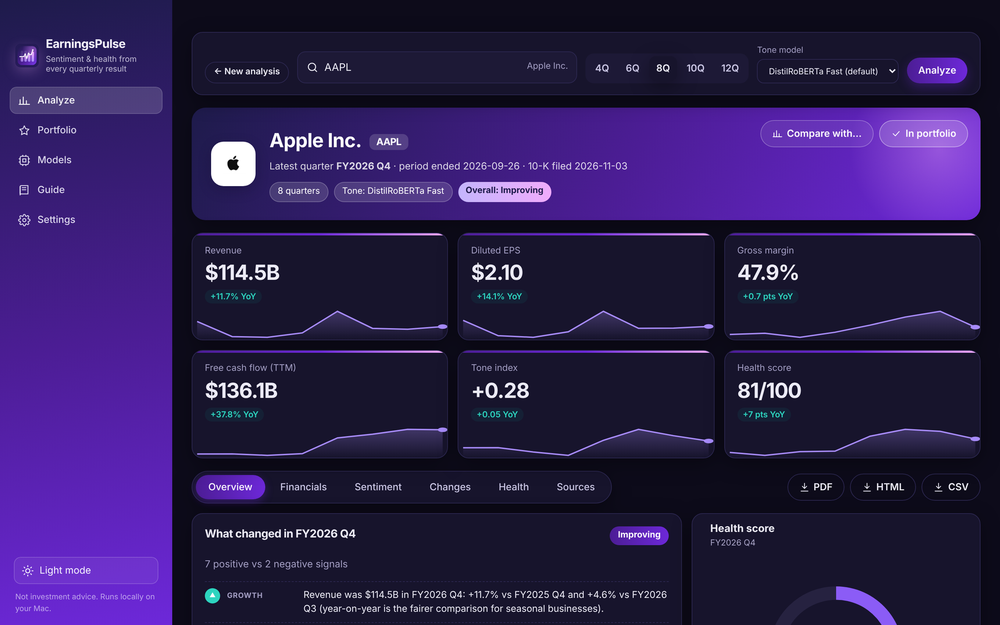
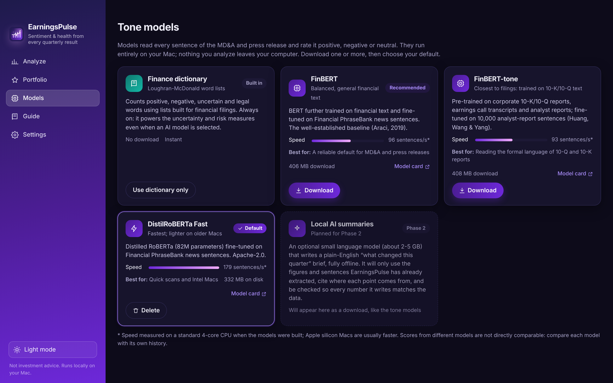
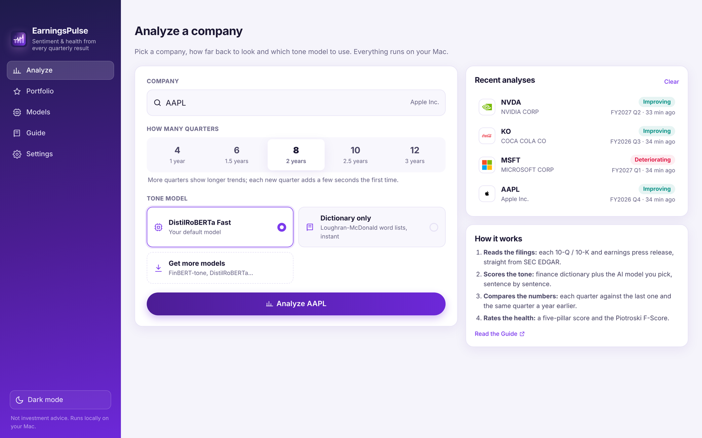
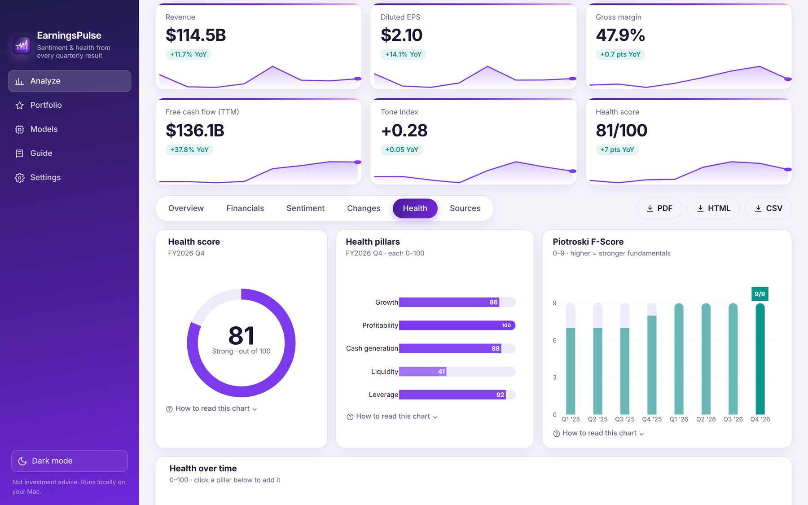
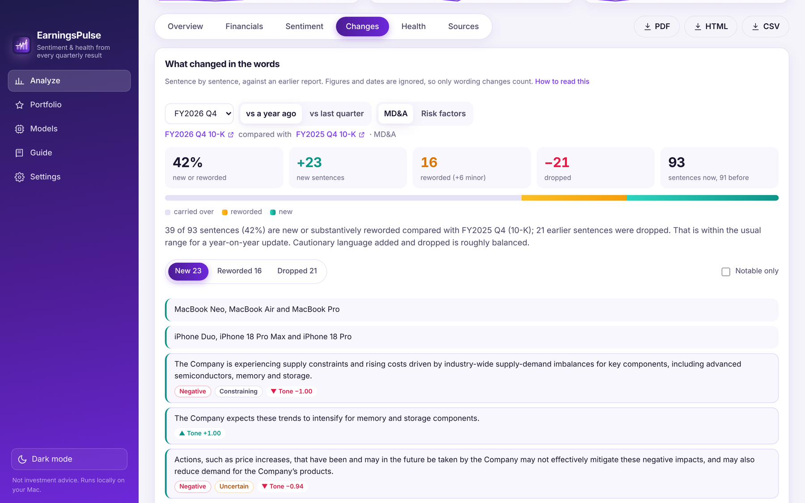
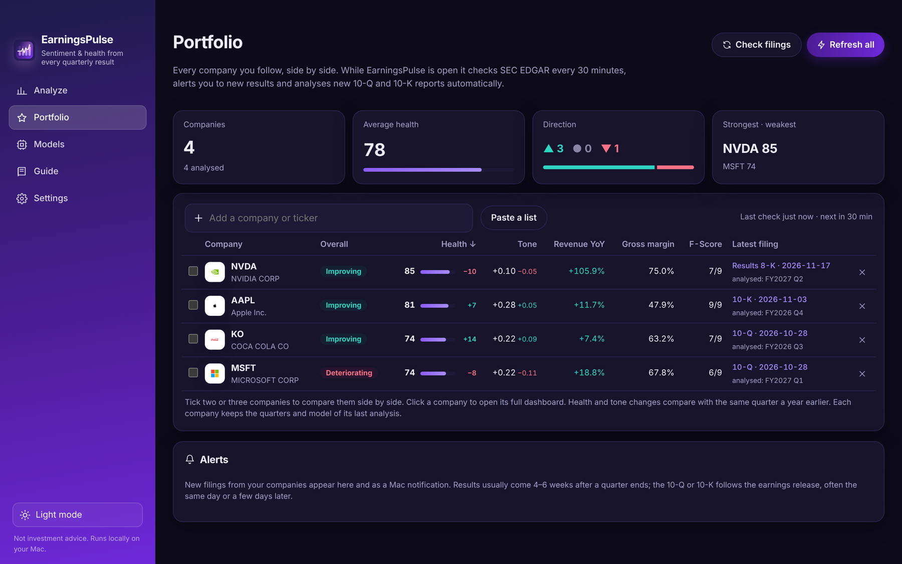
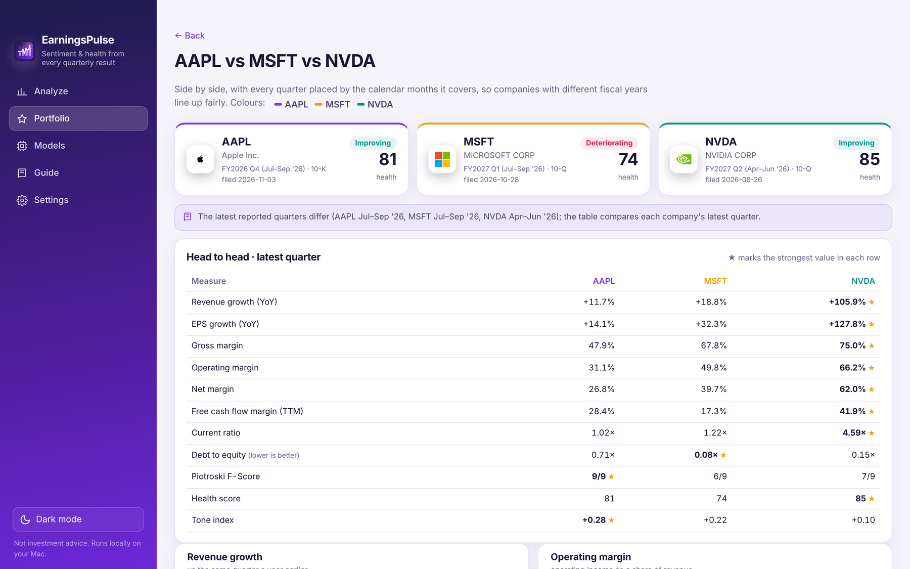
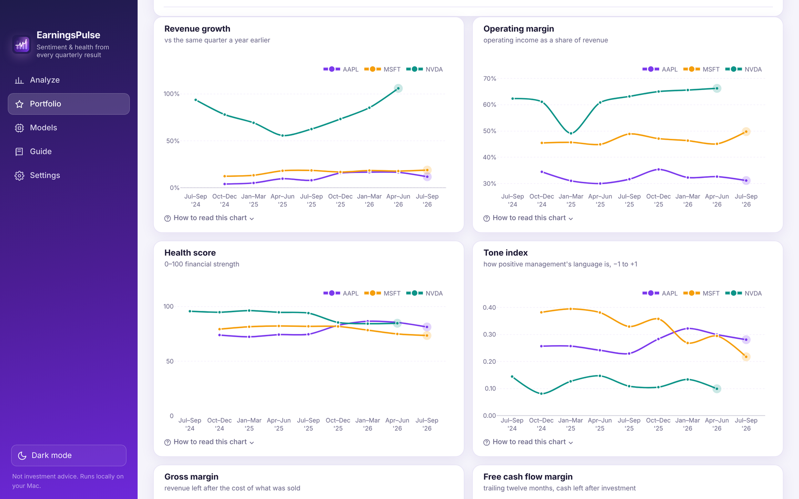

# 📈 EarningsPulse

**Sentiment & health from every quarterly result.**

[](https://github.com/zabriskieone/earnings-sentiment/actions/workflows/tests.yml)

EarningsPulse is a free Mac app (plus a browser version for Linux and Windows) that reads
every quarterly result a company files with the US SEC and shows:

* **Management tone**: is the language in the MD&A and the earnings press release
  getting more positive or more cautious? Scored with the Loughran-McDonald finance
  dictionary and an AI model of your choice (FinBERT, FinBERT-tone or DistilRoBERTa),
  all running on your own computer.
* **Financial trends**: revenue, EPS, margins, cash flow and balance sheet, each
  compared with the **previous quarter** and the **same quarter last year**.
* **Financial health**: a transparent 0–100 scorecard plus the Piotroski F-Score.
* **What changed**: a plain-English summary of the latest quarter with an overall
  *Improving / Stable / Deteriorating* call.
* **What changed in the words** *(new in 0.4)*: every sentence of the MD&A and risk
  factors matched against the same quarter last year (or last quarter): new,
  reworded and dropped sentences, with cautionary language flagged.
* **Portfolio and alerts** *(new in 0.4)*: follow your companies in one sortable
  table (health, tone, growth, margins), paste a list of tickers to add them all,
  and get a Mac notification when one files new results; new 10-Q/10-K reports are
  analysed automatically while the app is open.
* **Compare companies** *(new in 0.4)*: two or three side by side, lined up by
  calendar quarter so different fiscal years compare fairly.
* **Downloadable report** in HTML (interactive charts, works offline) or PDF,
  plus CSV/JSON data.

Search **any company that files 10-Q/10-K reports with the SEC**, then press
*Analyse*. Every figure links back to the filing it came from.



> **Disclaimer**: a hobby research tool. Automated text and ratio analysis of
> public filings is not investment advice. Verify figures against the linked
> filings.

---

## Install the Mac app

Open **Terminal** and paste:

```bash
curl -fsSL https://raw.githubusercontent.com/zabriskieone/earnings-sentiment/main/install-app.sh | bash
```

It downloads the latest release for your Mac (Apple silicon or Intel), puts **EarningsPulse** in your
Applications folder and opens it. Run the same line again to update; add `--uninstall` after `bash -s --`
to remove it.

Prefer a download? Get the `.dmg` from the [latest release](https://github.com/zabriskieone/earnings-sentiment/releases/latest)
(**arm64** = Apple silicon, **x64** = Intel) and drag the app to Applications. The app is not yet signed by Apple, so the
first time it is blocked: open **System Settings → Privacy & Security** and click **Open Anyway**. The Terminal install
above doesn't need this step.

**First launch:** enter your name and e-mail (the SEC requires it), then open **Models** to download an AI tone model:



| Model | Download | Best for |
|---|---|---|
| [FinBERT](https://huggingface.co/ProsusAI/finbert) | 406 MB | A reliable default for MD&A and press releases |
| [FinBERT-tone](https://huggingface.co/yiyanghkust/finbert-tone) | 408 MB | The formal language of 10-Q and 10-K reports |
| [DistilRoBERTa Fast](https://huggingface.co/mrm8488/distilroberta-finetuned-financial-news-sentiment-analysis) | 306 MB | Quick scans and Intel Macs (about 2x faster) |

The models are converted to ONNX by [`tools/export_models.py`](tools/export_models.py) and checked to give exactly the same
results as the originals; they run on your Mac's CPU with no data sent anywhere.

## Browser version (Mac, Linux, Windows)

### Mac or Linux: one command

Open **Terminal** and paste:

```bash
curl -fsSL https://raw.githubusercontent.com/zabriskieone/earnings-sentiment/main/install.sh | bash
```

That's it. It downloads EarningsPulse to `~/EarningsPulse`, sets everything up, asks two quick questions
(include the FinBERT AI model? your name and e-mail for the SEC) and opens the dashboard at
<http://localhost:8501>. The first run takes a few minutes; after that it starts in seconds.

**Next time:** double-click **`Start EarningsPulse.command`** in the `EarningsPulse` folder (first time:
right-click it, choose *Open*, then *Open* again so macOS allows it), or run `~/EarningsPulse/start.sh`.
Running the one-liner again also updates the app to the latest version.

### Windows: one command

Open **PowerShell** and paste:

```powershell
irm https://raw.githubusercontent.com/zabriskieone/earnings-sentiment/main/install.ps1 | iex
```

Needs Python 3.10+ from [python.org](https://www.python.org/downloads/windows/) (tick *Add python.exe to PATH*).
Next time, double-click **`start.bat`** in `%USERPROFILE%\EarningsPulse`.

> Prefer to look before you run? Both installers are short and readable:
> [`install.sh`](install.sh), [`install.ps1`](install.ps1), [`start.sh`](start.sh), [`start.bat`](start.bat).
> Or download the repo (green **Code → Download ZIP**) and double-click the start file yourself.

**What the installer does**
- uses your Python 3.10+, or offers to install one automatically with [uv](https://docs.astral.sh/uv/) if you have none (Mac/Linux);
- keeps everything inside the app folder (`.venv`), so nothing else on your computer changes;
- saves your SEC name and e-mail in `.env` on your computer only (never uploaded);
- only reinstalls packages when an update changes them.

To remove EarningsPulse, delete the `EarningsPulse` folder.

### Docker (alternative)

```bash
git clone https://github.com/zabriskieone/earnings-sentiment.git && cd earnings-sentiment && docker compose up --build
```

Then open <http://localhost:8501>. For a smaller image without FinBERT:
`docker compose build --build-arg WITH_FINBERT=false`.

### Manual setup (developers)

```bash
python -m venv .venv && source .venv/bin/activate
```
```bash
pip install -r requirements.txt -r requirements-finbert.txt
```
```bash
streamlit run app.py
```

### New to earnings reports?

Open the **Guide** tab in the app for a plain-English primer and glossary, or click **How to read this chart**
under any chart.

---

## How long does an analysis take?

| | First run | Repeat run |
|---|---|---|
| Dictionary only, 8 quarters | ~20–40 s (downloads ~30 filings from SEC) | ~2 s (disk cache) |
| With FinBERT, 8 quarters | + ~30–60 s on a laptop CPU (+ one-time model download) | ~2 s |

SEC downloads and sentiment scores are cached in `data/cache/`, so only new
filings are fetched after each results day.

---

## Tracking your portfolio over time (git workflow)

After a company reports, save a dated snapshot and commit it (run these from the app folder; `.venv/bin/python`
is the environment the installer created, or use `python` if you set things up manually):

```bash
.venv/bin/python -m earnings_sentiment snapshot AAPL
```
```bash
git add snapshots && git commit -m "AAPL FY2026 Q4 results snapshot"
```

This writes:

```
snapshots/AAPL/
├── history.csv                # one row per quarter: revenue, margins, tone, health, verdict
└── FY2026-Q4/
    ├── summary.json           # every score + links to the source filings
    ├── report.html            # the full report
    └── report.pdf
```

Several tickers at once: `.venv/bin/python -m earnings_sentiment snapshot AAPL MSFT NVDA`.
Over time, `git log -p snapshots/AAPL/history.csv` shows exactly how each quarter
was read when it came out.

---

## What's inside

Pick a company, how many quarters and a tone model:



Every dashboard has six tabs. Light and dark mode follow your Mac, or switch with the button at the bottom of the sidebar.



| Tab | Shows |
|---|---|
| **Overview** | KPIs with YoY change, "what changed" bullets, revenue and tone charts |
| **Financials** | Revenue/net income, YoY growth, margins, cash flow and buybacks, net cash vs debt, quarterly table |
| **Sentiment** | Tone index, tone by document and method, LM word categories, risk-factor length, and the **evidence sentences** behind each score |
| **Changes** *(Mac app)* | New, reworded and dropped sentences in the MD&A or risk factors vs a year ago or last quarter, with word-level highlights |
| **Health** | Pillar scores, health trend, Piotroski F-Score with every signal |
| **Guide** | A primer for beginners, every chart explained, and a searchable glossary |
| **Sources & method** | Links to every filing used and a method summary |

**Changes**: what management added, reworded or dropped since the same quarter last year.



**Portfolio** lists every company you follow with its latest verdict, health, tone, revenue
growth, margins and F-Score, and alerts you when one files new results.



Tick two or three rows to **Compare** them, lined up by calendar quarter:





**Data sources (all free and official)**

* SEC EDGAR APIs — <https://www.sec.gov/search-filings/edgar-application-programming-interfaces>
* 10-Q / 10-K: MD&A and Risk Factors sections
* 8-K Item 2.02, Exhibit 99.1: earnings press release
* Company logos: Financial Modeling Prep public image URL, by ticker (`financialmodelingprep.com/image-stock/<TICKER>.png`). Only the ticker is sent, logos are cached locally, and a monogram tile is shown when none exists

**Methods** (full details and formulas in [docs/METHODOLOGY.md](docs/METHODOLOGY.md))

* Loughran & McDonald (2011), *Journal of Finance* 66(1) — finance sentiment word lists. <https://doi.org/10.1111/j.1540-6261.2010.01625.x>
* Araci (2019), *FinBERT* — <https://arxiv.org/abs/1908.10063>, model [`ProsusAI/finbert`](https://huggingface.co/ProsusAI/finbert)
* Piotroski (2000), *Journal of Accounting Research* 38 — F-Score. <https://doi.org/10.2307/2672906>
* Li (2010), *Journal of Accounting Research* 48(5) — MD&A tone predicts future performance. <https://doi.org/10.1111/j.1475-679X.2010.00382.x>
* Cohen, Malloy & Nguyen (2020), *Lazy Prices*, *Journal of Finance* 75(3) — changes in 10-K/10-Q wording predict future returns (basis of the Changes tab). <https://doi.org/10.1111/jofi.12885>

---

## Project layout

```
install-app.sh                 one-line installer for the Mac app
desktop/                       Mac app: Tauri shell (src-tauri/) + React interface (src/)
packaging/engine.spec          PyInstaller recipe that bundles the Python engine into the app
tools/export_models.py         builds the ONNX sentiment models published on GitHub Releases
install.sh / install.ps1       one-line installers for the browser version (Mac/Linux, Windows)
start.sh / start.bat           launchers (also "Start EarningsPulse.command" for macOS Finder)
app.py                         Streamlit dashboard
src/earnings_sentiment/
  edgar.py                     SEC client (rate-limited, disk-cached)
  periods.py                   fiscal-quarter mapping (52/53-week years)
  financials.py                XBRL facts -> quarterly table (Q4 derivation, TTM, YoY)
  textextract.py               MD&A / risk-factor / press-release extraction
  sentiment.py                 Loughran-McDonald + FinBERT scoring
  health.py                    scorecard + Piotroski F-Score
  analysis.py                  orchestration
  narrative.py                 "what changed" rules
  textdiff.py / changes.py     sentence-level comparison of two filings (Changes tab)
  watchlist.py                 followed companies, new-filing checks and alerts
  compare.py                   side-by-side comparison by calendar quarter
  charts.py                    Plotly charts
  explain.py                   "how to read" guides and glossary
  logos.py                     company logos with monogram fallback
  theme.py                     EarningsPulse look, light/dark palettes
  models.py                    model catalogue, downloads (checksummed), ONNX inference
  server.py                    local engine API used by the Mac app
  report.py                    HTML + PDF reports
  cli.py                       `snapshot` command
tests/                         offline unit tests (pytest)
snapshots/                     committed quarterly snapshots
docs/METHODOLOGY.md            how every number is computed, with references
```

Run the tests: `pip install -r requirements-dev.txt && pytest`.

---

## Hosting it later (optional)

The app runs unchanged on hosted platforms if you want a public URL:

* **Hugging Face Spaces** (free CPU tier: 2 vCPU, 16 GB RAM, sleeps after 48 h idle)
  has enough memory for FinBERT. Create a *Docker* Space and push this repository;
  set `SEC_USER_AGENT` as a Space secret.
  Docs: <https://huggingface.co/docs/hub/en/spaces-overview>
* **Streamlit Community Cloud**: free, but its memory limit (about 1–2.7 GB) is tight
  for FinBERT. Use it with `requirements.txt` only (dictionary mode).
  Docs: <https://docs.streamlit.io/deploy/streamlit-community-cloud/manage-your-app>

---

## Limitations

* US SEC filers with 10-Q/10-K only (no 20-F/6-K foreign issuers yet).
* Segment and regional revenue are not yet extracted (they need XBRL dimensions).
* Earnings-call transcripts are not included (licensing).
* Health thresholds are generic; tune `THRESHOLDS` in `health.py` for your sectors.

## License

MIT — see [LICENSE](LICENSE). The Loughran-McDonald word lists are © their authors.
The bundled copy comes from the MIT-licensed `pysentiment2` package. The official
dictionary is free for academic use, and commercial use needs a licence from the
authors.
